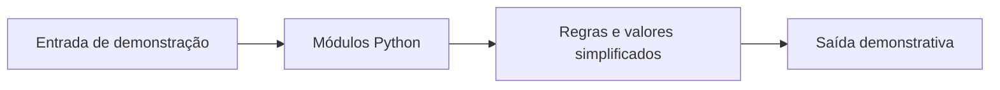

 |  | 

# Aurora Sovereign Intelligence — Módulos Demonstrativos

## Visão geral

O README atual apresenta o projeto como um núcleo de inteligência soberana ligado à Impulso Digital e à soberania tecnológica brasileira. O conteúdo verificável é um repositório de módulos e exemplos Python: inclui um motor demonstrativo que transforma texto para maiúsculas, lógica que produz um hash módulo 369, uma assistente com retorno textual, interfaces chamadas AuroraChain e um coordenador AuroraSystem que importa módulos de raciocínio, memória, agentes, predição, ingestão e segurança. Isso sustenta a descrição de protótipo/coleção modular; não comprova soberania operacional, inteligência autônoma ou integração externa funcional.

## Objetivo e valor

**Problema/escopo:** Protótipo Python modular Aurora com exemplos de processamento de dados, agentes, análise de risco, memória e módulos de blockchain.

**Valor verificável hoje:** o repositório torna explícitos seus artefatos, interfaces e limitações para que mantenedores e contribuidores possam avaliar o que existe sem confundir demonstração, proposta e produção.

## Arquitetura e tecnologias

Documentada conceitualmente e organizada em diretórios (aurora_core, agents, memory, prediction, data_ingestion, security, blockchain e core). aurora_system.py compõe classes dessas áreas e expõe métodos como process_query, assess_risk_scenario, predict_trend e monitor_security. ARCHITECTURE.md descreve camadas e fluxos, mas escalabilidade, segurança, desempenho e integração descritos ali não foram validados; classificável como arquitetura modular declarada, não comprovada em operação.

- Python (linguagem indicada pelo GitHub e pelos arquivos-fonte).
- requirements.txt declara web3, tensorflow, torch, numpy, pandas, scikit-learn, openai, langchain, huggingface-hub, fastapi, uvicorn, gunicorn, python-dotenv e requests; a presença no manifesto não prova uso efetivo de todos.
- Dockerfile usa python:3.9-slim-buster e instala requirements.txt; não houve build/teste do container.

## Início rápido

Os comandos abaixo refletem instruções, manifestos ou pontos de entrada presentes no repositório. Dependências externas, segredos e serviços estão indicados quando aplicável; a presença de um comando não equivale a uma execução validada.

1. O README atual não contém instruções de instalação ou execução.
2. setup.sh executa pip install -r requirements.txt; linhas de criação/ativação de ambiente virtual estão comentadas. O comando de instalação está no arquivo, mas não há execução validada registrada.
3. setup.sh imprime como exemplos python core/engine.py, python core/logic_369.py, python blockchain/aurora_chain.py e python agents/aninha_assistant.py. São comandos sugeridos pelo script, não execução comprovada.
4. DEPLOYMENT_GUIDE.md indica python aurora_system.py e python examples/usage_example.py; os arquivos têm blocos __main__, mas esses comandos não foram executados.
5. O Dockerfile declara CMD ["python", "core/engine.py"] e inclui exemplos comentados de docker build/run; build e execução não foram verificados.

## Exemplo de uso

Exemplo baseado no arquivo existente: python examples/usage_example.py chama AuroraEngine.process_data, Logic369.optimize, AuroraChain.connect_ton/integrate_drex e AninhaAssistant.manage_task. Pelas implementações inspecionadas, o motor retorna texto em maiúsculas, Logic369 retorna um valor baseado em hash e a assistente retorna uma mensagem; connect_ton/integrate_drex também retornam mensagens/strings fixas, não demonstrando conexão real com TON ou DREX. O comando não foi executado.

## Estado e limitações

**Maturidade indicada:** Demonstração.

- Não executei instalação, exemplos, testes ou Docker; a presença de instruções, arquivos e testes não comprova que passem.
- As implementações examinadas de TON/DREX, Logic369 e Aninha são retornos simplificados; não descrevê-las como integração blockchain, IA ou otimização operacional sem evidência adicional.
- ARCHITECTURE.md afirma métricas de desempenho, escalabilidade e garantias de segurança sem evidência de validação na fonte examinada.
- DEPLOYMENT_GUIDE.md menciona endpoints HTTP, aurora_system:app e scripts como scripts/optimize_indexes.py e scripts/migrate.py; não encontrei esses scripts na árvore consultada e aurora_system.py não declara app FastAPI. Tratar esses passos como não verificados.

## Contribuição

Leia [CONTRIBUTING.md](CONTRIBUTING.md) antes de abrir uma issue ou pull request. Para reportes de segurança, siga a orientação específica do repositório, se houver.

## Licença

Este repositório está licenciado sob **Apache-2.0**; consulte [LICENSE](LICENSE).

## Patrocínio e apoio

O desenvolvimento aberto exige tempo para manutenção, documentação, testes, revisão de contribuições e resposta a issues. Se este projeto for útil, considere apoiar a continuidade pelo [GitHub Sponsors](https://github.com/sponsors/felipetjmg1-bit). O apoio não representa promessa de funcionalidades, prazo de entrega ou suporte comercial.

